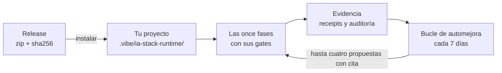
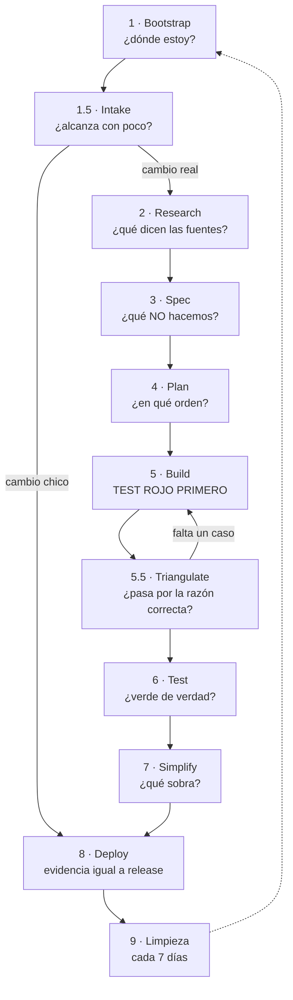
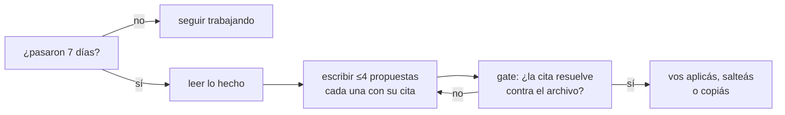

<div align="center">

# IA Stack

**Un protocolo de once fases para que una IA cambie código sin inventar que lo revisó, lo probó o lo entendió.**

[](https://github.com/santischurmann/ia-stack/actions/workflows/ci.yml)
[](https://github.com/santischurmann/ia-stack/releases/latest)
[](LICENSE)

[Qué es](#qué-es) · [El problema](#el-problema-que-resuelve) · [Cómo funciona](#cómo-funciona) · [Instalación](#instalación) · [Uso rápido](#uso-rápido) · [Estructura](#estructura-del-repositorio) · [Releases](#releases)

</div>

---

## Qué es

IA Stack ayuda a una IA a cambiar código sin inventar que revisó, probó o entendió algo. Es un
**harness descargable**: una skill para agentes de programación (Claude Code, y Codex a través de
`AGENTS.md`) que bajás de la página de *Releases* e instalás dentro de tu proyecto. Está pensado para
desarrollar **webs, PWA y aplicaciones de escritorio**. No es un linter ni un framework: no tiene
dependencias y sus chequeos son scripts de Node nativo.

| Parte | Qué hace |
|---|---|
| **Protocolo** | Once fases. Cada una cierra con un chequeo (*gate*) que se ejecuta y frena si falta evidencia. |
| **Runtime** | Una copia autocontenida de los gates, las plantillas y las fases, instalada dentro de tu proyecto en `.vibe/ia-stack-runtime/`. |
| **Bucle de automejora** | Cada 7 días propone cambios al propio protocolo, cada uno con la cita que lo respalda. |

> **Se llama IA Stack: el repositorio, el protocolo y la skill.** Hasta el 15-09-2026 el protocolo se
> llamaba `VibeCodeProtocols`. El comando `/VibeCodeProtocols` se retiró en la 3.4.0: nunca llegó a
> cargar en Claude Code, porque el instalador lo dejaba como archivo suelto. Una prueba comprueba que
> este README siga nombrando al repositorio donde vive, `ia-stack`.

---

## El problema que resuelve

Una IA que programa puede decirte «lo probé y anda» sin haber corrido nada. No miente a propósito:
no tiene forma de distinguir lo que ejecutó de lo que supone.

| Sin IA Stack | Con IA Stack |
|---|---|
| «Ahora debería andar.» | Se muestra la salida real de un comando, o la fase no cierra. |
| El test se escribe después del código, y pasa por casualidad. | **Sin un test que falle a la vista, no se escribe código.** |
| «Revisé todo.» | El receipt guarda qué se revisó, con qué comando y qué dio, y el gate lo compara con el árbol de Git. |
| Se construye una pantalla que nadie vio. | Toda pieza visible se muestra como preview y se aprueba **antes** de la primera línea de código. |
| Un gate que pasó sin comparar nada se lee como verde. | Ese caso se escribe distinto, `VACÍO:` en vez de `OK:`. |
| Se publica por cansancio o por apuro. | Un solo push, al final, con todo verde; y producción sólo con una orden explícita atada al sha exacto. |

**Cada fase cierra con evidencia verificable**, y cada chequeo declara además qué **no** puede detectar.

---

## Cómo funciona



La idea de fondo cabe en una línea:

```text
entender -> decidir -> test rojo -> cambio chico -> casos borde -> revisión -> evidencia -> release
```

### Las once fases



Cada fase vive en su propio archivo de [`phases/`](phases/), y el agente lee sólo la que está en curso.
La tabla dice qué responde cada una y cuáles son algunos de los gates que la respaldan (la lista
completa y el límite de cada gate están en [`skills/gates.md`](skills/gates.md)):

| Fase | Pregunta que responde | Gates que la respaldan |
|---|---|---|
| 1. Bootstrap | ¿Qué proyecto y qué feature son ésta? | `verify-feature-activa`, `verify-session-state`, `verify-runtime-sync` |
| 1.5. Intake | ¿Alcanza con un cambio chico o hace falta el ciclo entero? | `verify-intake`, `verify-stack-matrix` |
| 2. Research | ¿Qué está roto de verdad, qué dicen las fuentes y qué hay que proteger? | `verify-discovery-core`, `verify-research-candidates`, `verify-evidence-trace` |
| 3. Spec | ¿Qué problema resolvemos y qué **no**? | `verify-spec-wordcap`, `verify-egm-convergencia`, `verify-aprobacion-humana` |
| 4. Plan | ¿Qué se toca y en qué orden? | `verify-plan-conflicts`, `verify-task-shape`, `verify-adr` |
| 5. Build | ¿La conducta está probada **antes** de cambiarla? | `verify-red-node`, `verify-red`, `verify-scope-diff`, `pretooluse-red` |
| 5.5. Triangulate | ¿El test pasa por la razón correcta? | `verify-triangulate` |
| 6. Test | ¿Está todo verde de verdad, o sólo lo que miré? | `verify-receipt`, `verify-security-baseline`, `verify-test-bindings`, `verify-empty-probe` |
| 7. Simplify | ¿Qué sobra ahora que funciona? | Se saca con su motivo; la suite sigue en verde |
| 8. Deploy | ¿La evidencia coincide con lo que se libera, y la cosa arranca? | `verify-deploy`, `verify-audit-chain`, `verify-phase-decisions`, `verify-aprobacion-humana` |
| 9. Limpieza | ¿Qué se acumuló y ya no sirve? | `autolimpieza`, `verify-sereno`, `verify-autolimpieza` |

Son las mismas fases que declara `SKILL.md`: una prueba lo comprueba, y si los dos documentos se
separan, la suite se pone roja.

### Las leyes que no se negocian

Las leyes completas están en `SKILL.md`; estas son las que más se notan en el trabajo diario:

| Ley | Qué exige |
|---|---|
| **1** | Sin test rojo visto, no hay implementación. Cero excepciones. |
| **2** | Un subagente, una tarea atómica. |
| **8** | Sin receipt aprobado para el estado evaluado, no hay push ni merge. |
| **9** | Publicar es **una vez, al terminar**: nada de push por fase, por lote o «para respaldar». |
| **10** | Preview antes de escribir código; la aprobación queda en `.vibe/APROBACIONES.md` con fecha `DD-MM-AAAA HH:MM`. |
| **11** | Producción sólo con una orden explícita y vigente, atada al sha exacto y usada una sola vez. |

Cuando una decisión cambia alcance, costo, riesgo o publicación, el agente presenta opciones con una
recomendación explícita y espera la respuesta humana: no elige por silencio.

### Las piezas

| Pieza | Dónde está | Para qué sirve |
|---|---|---|
| **Gates** | [`scripts/`](scripts/) | Scripts Node sin dependencias, `verify-*.mjs` en su mayoría. Salen con código distinto de cero si falta evidencia y se corren, no se narran. |
| **Contratos** | [`contracts/`](contracts/) | Datos revisables que los gates leen: `honest-limits.json` (lo que cada chequeo **no** detecta), `model-routing.json` (reparto de modelos), `empty-probe.json`, `repo-clean.json`, entre otros. |
| **Skills** | [`skills/`](skills/) | Sub-skills que cada fase nombra cuando las necesita: `gates`, `research`, `receipt`, `security-baseline`, los `subagent-*` y `egm-panel-audiencia`, entre otras. |
| **Fases** | [`phases/`](phases/) | Un archivo por fase, más las reglas extendidas y los menús de decisión. |
| **Plantillas** | [`templates/`](templates/) | Spec, plan, tareas, intake, ADR y el esqueleto de `.vibe/` que el protocolo llena en tu proyecto. |
| **Revisión goldfish (EGM)** | Fase 3 (`phases/04-spec.md`) | Revisión de la spec y del plan con subagentes nuevos y de sólo lectura, alineada con el plugin externo `egm@egm`. `verify-egm-convergencia` comprueba que el panel obligatorio corrió y que las últimas rondas no dejan Blocker ni Major sin asentar. |
| **Hooks opcionales** | `scripts/context-guard.mjs`, `scripts/pretooluse-red.mjs` | `context-guard` avisa cuándo hacer el handoff (al 70 % del tope de mensajes, sale siempre con 0); `pretooluse-red` pone fricción sobre `Write` y `Edit` sin un rojo previo. El instalador **no** toca hooks: se cablean a mano en `settings.json`. |
| **Tablero** | `scripts/tablero.mjs`, `scripts/tablero-servidor.mjs` | Un tablero del estado del proyecto, escrito a un archivo o servido en `127.0.0.1`. |

### El plugin EGM

La revisión goldfish no está dentro de este repositorio: usa el plugin `egm@egm` (0.1.0 al momento
de la 3.4.2), que aporta las skills `/egm:egm-brainstorm`, `/egm:egm-draft`, `/egm:egm-review` y
`egm-resolve`, y los revisores de sólo lectura (`egm:egm-zoom-out`, `egm:egm-comprehension`,
`egm:egm-design`, `egm:egm-structural`, `egm:egm-style`, `egm:egm-implementation-readiness` y
`egm:egm-codebase-details`). Pide Claude Code 2.1.271 o más nuevo; sin subagentes frescos, EGM frena.
IA Stack aporta el panel de audiencia para piezas públicas y el gate de convergencia.

### El bucle de automejora

Cada 7 días, al abrir sesión, el protocolo mira lo que se hizo y propone **como mucho cuatro**
mejoras. El tope es la feature: una lista de veinte no se lee, se archiva.



**No ejecuta nada.** Escribe un archivo en `docs/mejoras/` y ahí termina; el gate rechaza cualquier
registro que traiga un comando adentro. Cada propuesta cita el archivo y el texto exacto de donde
salió, y el gate **busca ese texto en ese archivo**.

```bash
node scripts/verify-sereno.mjs due              # ¿toca una ronda?
node scripts/verify-sereno.mjs check docs/mejoras/2026-09-05.json
```

**Lo que no puede hacer:** comprueba que la propuesta tenga origen, no que valga la pena. Y que el
texto citado esté ahí, no que signifique lo que la propuesta dice.

---

## Instalación

### Requisitos

| Qué | Para qué |
|---|---|
| **Claude Code** (o un agente que lea `AGENTS.md`) | Es quien sigue el protocolo. EGM pide Claude Code 2.1.271 o más nuevo. |
| **Git** | Los gates comparan contra el árbol de Git. |
| **Node** | Todos los gates son `.mjs` de Node nativo. El CI corre con Node 24. |
| **Bash o PowerShell** | Sólo para el instalador y las entradas de RED. |

No hay `package.json` ni dependencias que instalar: un paso del CI falla si aparece uno.

### Desde una release

En la página [*Releases*](https://github.com/santischurmann/ia-stack/releases) bajá el archivo
**`ia-stack-<versión>.zip`** y su **`.sha256`**. No uses el «Source code (zip)» que GitHub agrega
solo: se llama igual y abre en otra carpeta. Verificalo y descomprimilo en una carpeta vacía; sobre
una carpeta `ia-stack/` que ya existe se mezclarían dos versiones.

```bash
sha256sum -c ia-stack-<versión>.sha256        # en macOS: shasum -a 256 -c ia-stack-<versión>.sha256
unzip ia-stack-<versión>.zip && cd ia-stack
```

En PowerShell, el checksum se compara con el del archivo y tiene que dar `True`:

```powershell
(Get-FileHash ia-stack-<versión>.zip -Algorithm SHA256).Hash -eq ((Get-Content ia-stack-<versión>.sha256) -split '\s+')[0]
```

### Desde un clon

```bash
git clone https://github.com/santischurmann/ia-stack.git
cd ia-stack
```

### Instalar en tu proyecto

```bash
./scripts/install.sh --project /ruta/a/mi-proyecto
```

En Windows PowerShell:

```powershell
.\scripts\install.ps1 -ProjectDir C:\ruta\a\mi-proyecto
```

El instalador deja la skill `ia-stack` donde Claude Code la descubre, un puntero en `.agents/skills/`
del proyecto para Codex, y un **runtime completo** en `.vibe/ia-stack-runtime/`, con un sello
(`INSTALADO.json`) que dice cuándo y desde qué commit se instaló. Reinstalar actualiza el runtime y
**aparta, sin borrar**, lo que el protocolo ya no tiene. Opciones del instalador: `--target-dir`,
`--runtime-dir`, `--project` y `--project-only` (en PowerShell, `-TargetDir`, `-RuntimeDir`,
`-ProjectDir` y `-ProjectOnly`). El detalle está en [`INSTALL.md`](INSTALL.md).

---

## Uso rápido

1. Reiniciá tu agente y abrí el proyecto.
2. Invocá `/ia-stack`. El agente lee el núcleo (`SKILL.md`) y, de ahí en más, sólo el archivo de la
   fase en curso.
3. Los comandos salen de `.vibe/ia-stack-runtime/scripts/`, nunca del clon original.

Comandos que vas a usar seguido, todos desde el runtime instalado:

```bash
node .vibe/ia-stack-runtime/scripts/verify-feature-activa.mjs check
node .vibe/ia-stack-runtime/scripts/verify-graphify-manifest.mjs check
node .vibe/ia-stack-runtime/scripts/verify-sereno.mjs due
node .vibe/ia-stack-runtime/scripts/verify-adr.mjs check
node .vibe/ia-stack-runtime/scripts/verify-scope-diff.mjs check --tasks docs/tasks.json --task T01 --base HEAD
node .vibe/ia-stack-runtime/scripts/verify-backup-state.mjs check .vibe/backup.json
node .vibe/ia-stack-runtime/scripts/registrar-tokens.mjs check
node .vibe/ia-stack-runtime/scripts/informe-tokens.mjs
```

Una prueba **corre** los comandos de este archivo y falla si alguno muere con `usage:`. Si usás la
integración con un grafo externo, el export se verifica con
`verify-obsidian-export.mjs check graphify-out/obsidian`.

### Tabla de comandos

Todos se invocan como `node .vibe/ia-stack-runtime/scripts/<script>` desde tu proyecto. Los usos de
abajo son los que declara cada script.

| Comando | Qué hace |
|---|---|
| `verify-red.mjs check --test <archivo> --command "<runner>"` | Comprueba que el test falle a la vista antes de implementar (adapters para Node, Vitest y pytest). |
| `verify-receipt.mjs check <receipt.json>` | Valida que el árbol de Git siga siendo el que se revisó. |
| `verify-menu-shape.mjs check <archivo.md>` | Comprueba que cada decisión sea una lista con recomendación explícita y línea de espera. |
| `verify-aprobacion-humana.mjs preview <APROBACIONES.md> --pieza <id>` | Verifica que el preview de una pieza esté aprobado. También `tareas` y `produccion --sha <sha>`. |
| `verify-egm-convergencia.mjs check <registro.json>` | Comprueba que la revisión goldfish convergió. |
| `verify-brief-size.mjs check <brief.md>` | El brief de un subagente: 4K tokens y 3 archivos como máximo. |
| `verify-handoff-report.mjs check <reporte.md>` | El reporte de vuelta: 40 líneas como máximo. |
| `registrar-tokens.mjs append --tarea <id> --rol <rol> --modelo <m> --in <n> --out <n> --escalo si\|no` | Registra el consumo en `.vibe/tokens.jsonl`, encadenado por hash. |
| `tablero.mjs build` / `tablero.mjs due` | Escribe el tablero / dice si toca. |
| `tablero-servidor.mjs serve [--port <n>]` | Sirve el tablero en `127.0.0.1`. |
| `autolimpieza.mjs listar\|aplicar\|purgar <contrato.json>` | Limpieza de la fase 9: archiva, no borra, y deja el comando de vuelta atrás (`restaurar <contrato.json> <item>`). |
| `limpiar-temporales.mjs listar` | Lista los temporales de las pruebas; borrar exige `--borrar`. |

Los gates del propio repositorio, desde un clon:

| Comando | Qué hace |
|---|---|
| `node --test` | La suite completa. |
| `node scripts/verify-ia-stack-contract.mjs check` | Las promesas visibles del protocolo y sus límites honestos siguen escritos. |
| `node scripts/verify-ia-stack-index.mjs check` | Cada archivo rastreado está declarado o excluido con motivo. |
| `node scripts/verify-repo-clean.mjs check` | El repositorio no publica la identidad de quien lo escribió ni rutas personales. |
| `node scripts/verify-private-names.mjs check --require-inputs` | El repositorio no nombra nada de una lista privada. Ver el límite abajo. |
| `node scripts/verify-platform-scope.mjs check` | Toda prueba que no corre en una plataforma lo declara. |
| `node scripts/verify-empty-probe.mjs check contracts/empty-probe.json` | Cada gate se comporta sobre un directorio vacío como declara. |
| `node scripts/verify-runtime-sync.mjs check` | El runtime instalado es el del checkout. |
| `node scripts/verify-gate-docs.mjs check` | La documentación de los gates coincide con lo que hacen. |
| `node scripts/verify-ia-stack-coverage.mjs --coverage-dir <directorio>` | Cobertura de los scripts Node inventariados, sobre un directorio ya medido con `NODE_V8_COVERAGE`. |

`verify-private-names` lee su lista de la variable de entorno `IA_STACK_NOMBRES_PRIVADOS` o del
archivo local `.claude/nombres-privados.local.txt`, que Git no publica. Sin lista, `--require-inputs`
lo hace fallar a propósito: un verde que no miró nada no cuenta.

---

## Estructura del repositorio

```text
ia-stack/
├── .agents/skills/ia-stack/   puntero de la skill para agentes que leen AGENTS.md
├── .github/workflows/         ci.yml (suite y gates) y release.yml (zip y publicación)
├── .vibe/                     el estado del propio proyecto: decisiones, deuda, lecciones, receipts
├── contracts/                 datos que los gates leen: límites honestos, ruteo de modelos, alcance
├── docs/                      spec, plan, tareas, ADR, guía completa y mapa del protocolo
├── examples/                  una feature de ejemplo con spec, plan y tareas
├── phases/                    un archivo por fase, más reglas extendidas y menús
├── research/                  informes e inventarios de la investigación que dio origen al protocolo
├── scripts/                   gates (verify-*.mjs), instaladores, hooks y tablero
├── skills/                    sub-skills que cada fase nombra cuando las necesita
├── templates/                 plantillas de spec, plan, tareas, intake, ADR y del esqueleto de .vibe/
├── tests/                     la suite de node:test
├── AGENTS.md                  puntero para agentes: reglas independientes de la fase
├── CHANGELOG.md               qué cambió en cada versión
├── INSTALL.md                 instalación y desinstalación en detalle
├── LICENSE                    MIT
├── SECURITY.md                modelo de seguridad y límites
└── SKILL.md                   el núcleo del protocolo y su mapa de lectura
```

`.vibe/ia-stack-runtime/` dentro de este repositorio es una copia de trabajo y está ignorada por Git;
el protocolo se dogfoodea a sí mismo, y por eso el repositorio tiene su propio `.vibe/`.

---

## Releases

Las versiones siguen [SemVer](https://semver.org/lang/es/) y cada cambio queda en el
[`CHANGELOG.md`](CHANGELOG.md). Al empujar un tag `v*`, el workflow `release.yml`:

1. arma `ia-stack-<versión>.zip` y su `.sha256` con `scripts/build-zip.sh <versión>`;
2. instala ese zip en un proyecto vacío y comprueba que quede el sello `INSTALADO.json`;
3. toma las notas de la sección de esa versión del `CHANGELOG.md` (sin notas no se publica);
4. crea la release con el zip, el checksum y las notas.

El CI (`ci.yml`) corre en la rama principal y en los PR, sobre `ubuntu-latest` y `windows-latest`:
la suite una sola vez, los gates del repositorio sobre un clon limpio, y después la cobertura sobre la
**unión** de las dos plataformas.

---

## Qué garantiza, y qué no

Cada chequeo declara **qué NO puede detectar**, y esas frases están guardadas como datos revisables
en `contracts/honest-limits.json`. No son letra chica: si alguien borra una, el contrato lo rechaza.

La aclaración que vale para todo IA Stack: **los chequeos prueban forma, cadena y estado, nunca
verdad.** Pueden decirte que una decisión quedó registrada de forma coherente; no pueden decirte que
sea la decisión correcta, ni que la persona la haya entendido.

---

## Diccionario: qué significa cada palabra rara

| Palabra | Qué significa acá |
|---|---|
| **gate** | Un chequeo automático que deja pasar o frena. Un programa que responde sí o no, no una opinión. |
| **verde / rojo** | Verde = pasó. Rojo = frenó. |
| **verde vacío** | Un chequeo que pasó **sin haber comparado nada**, porque el archivo que tenía que mirar no existía. IA Stack lo escribe distinto: `VACÍO:` en vez de `OK:`. |
| **hash** | Una huella del contenido: un número largo que cambia si cambia un solo carácter. |
| **cadena de hashes** | Cada línea guarda la huella de la anterior. Editar una vieja rompe las que siguen. |
| **receipt** | Dónde queda escrito qué se verificó, con qué comando y qué dio. Evidencia para revisar, no prueba criptográfica. |
| **runtime** | La copia de IA Stack que vive **dentro** de tu proyecto. Es la herramienta, no tu código. |
| **RED / GREEN** | RED = escribir la prueba primero y **verla fallar**. GREEN = recién ahí, el código que la hace pasar. |
| **límite honesto** | Una frase que dice qué **no** detecta un chequeo, guardada como dato para que nadie la borre sin que se note. |
| **EGM** | Revisión goldfish: revisores nuevos y de sólo lectura que juzgan una spec o un plan sin el contexto del autor. |
| **slug** | El nombre corto de una feature: `integridad-verificable`. |

---

## Para leer más

| Documento | Qué tiene |
|---|---|
| **[`SKILL.md`](SKILL.md)** | El núcleo + mapa de lectura; cada fase vive en [`phases/`](phases/). Es lo que lee el agente. |
| **[`skills/gates.md`](skills/gates.md)** | Todos los chequeos, qué comprueba cada uno y qué **no** puede comprobar. |
| **[`skills/research.md`](skills/research.md)** | **Research: investigar antes de especificar**, la pasada de Discovery. |
| **[`skills/verificar-ia-stack.md`](skills/verificar-ia-stack.md)** | Cómo verificar el propio repositorio de IA Stack. |
| **[`SECURITY.md`](SECURITY.md)** | **Modelo de seguridad y límites**. |
| **[`INSTALL.md`](INSTALL.md)** | Instalación y desinstalación en detalle. |
| **[`docs/guia-completa.md`](https://github.com/santischurmann/ia-stack/blob/main/docs/guia-completa.md)** | La memoria entre sesiones, la autolimpieza, el tablero, las reglas de la suite y lo que cambió en cada versión mayor. Vive en GitHub: el zip no la trae. |

**Límites de contexto y tokens, dichos sin adorno:**

- El estimador de tokens es `ceil(caracteres / 4)`: aproximado a propósito, no es el tokenizador del modelo.
- `context-guard` (hook `UserPromptSubmit`) avisa, no cierra la sesión solo y sale siempre con 0. Los
  subagentes (`Agent`) no disparan `UserPromptSubmit`: su tope de 60K no lo controla un hook. El rol
  de una subsesión va por `IA_STACK_ROL`.
- Dos `append` simultáneos a `.vibe/tokens.jsonl` rompen la cadena: se registra de a uno.
- Los detectores de prosa larga y de topes son heurísticas acotadas, no un análisis de lenguaje.

---

## Licencia

[MIT](LICENSE). Las contribuciones pasan por el mismo protocolo que el código: sin test rojo visible,
no hay implementación.
